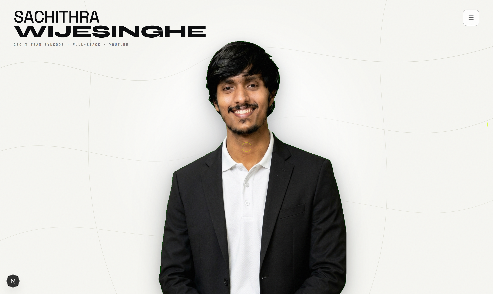

<div align="center">

# SACHITHRA WIJESINGHE

**Interactive 3D Creative Portfolio · Founder & CEO @ Team SYNCODE · Full-Stack Engineer · YouTube Creator & SLBC Radio Presenter**

[](https://nextjs.org/)
[](https://react.dev/)
[](https://threejs.org/)
[](https://tailwindcss.com/)
[](https://www.typescriptlang.org/)

<br />



</div>

---

## Overview

A scroll-driven interactive creative portfolio crafted for **Sachithra Wijesinghe** — combining crisp editorial minimalism on the landing stage with a persistent real-time **Three.js 3D story mode** across seven chapters.

### Highlights

- **Interactive `<<` SYNCODE Chevron Preloader** — Mouse-reactive 3D double-chevron boot sequence that splits open into the landing canvas.
- **Editorial Hero Stage** — Frameless studio cutout portrait grounded with soft directional shadows, pale topographic contour lines, and a wide right-side slide-in navigation drawer with brand-matched hover states.
- **7-Chapter 3D Scroll Story** — Smooth Lenis + GSAP scroll choreography paired with a real-time Three.js Black & White humanoid exosuit featuring a glowing Team SYNCODE `<<` chest reactor.
- **Team SYNCODE Studio Index** — Interactive client showcase with live site preview monitor covering 9+ shipped platforms.
- **Engineering & Systems Lens** — Industry experience at **Liveroom Technologies** plus toggleable **Architecture vs. Product & UX** views for full-stack and AI builds.
- **On Air & Creator Hub** — Live animated **SLBC Radio** equalizer, **YouTube (`@sachithra228`)** video deck, campus leadership, and references.
- **Static Export Ready** — Pre-rendered with `output: "export"` for instant deployment on Vercel, Netlify, or any static host.

---

## Story Chapters

| # | Chapter | Focus |
| :-: | :--- | :--- |
| `01` | **INITIATE** | Editorial landing stage with studio cutout portrait & right-side drawer |
| `02` | **THE CLONE** | Identity narrative, biometric scan portrait, & academic foundation (SLIIT) |
| `03` | **SYNCODE** | Founder & CEO studio showcase with live website preview monitor |
| `04` | **ENGINEERING** | Liveroom Technologies internship, UniFlow, Phishing Detection AI, RasaMenu & mobile apps |
| `05` | **ARSENAL** | Kinetic dual-direction tech marquee & full-stack technical matrix |
| `06` | **ON AIR** | YouTube `@sachithra228` tutorials, SLBC Radio presenting, leadership & mentors |
| `07` | **TRANSMIT** | Direct WhatsApp, one-click email copy, and social constellation |

---

## Tech Stack

- **Framework:** Next.js 16 (App Router, Static Export) · React 19 · TypeScript 5
- **3D & Motion:** Three.js (`RoomEnvironment` PBR lighting) · Framer Motion · GSAP ScrollTrigger · Lenis Smooth Scroll
- **Styling:** Tailwind CSS v4 · Syne, Space Grotesk & JetBrains Mono
- **Icons:** Lucide React

---

## Getting Started

```bash
# Install dependencies
npm install

# Run development server
npm run dev

# Build static production export
npm run build
```

Open [http://localhost:3000](http://localhost:3000) to view the portfolio locally.

All portfolio copy, projects, links, and media paths live in [`lib/content.ts`](./lib/content.ts).

---

## Connect

- **Studio:** [teamsyncode.com](https://www.teamsyncode.com/)
- **YouTube:** [@sachithra228](https://www.youtube.com/@sachithra228)
- **GitHub:** [Sachithra-228](https://github.com/Sachithra-228)
- **LinkedIn:** [Sachithra Wijesinghe](https://www.linkedin.com/in/sachithra-wijesinghe-5496a5270/)
- **Email:** [wijesinghesachithra@gmail.com](mailto:wijesinghesachithra@gmail.com)
